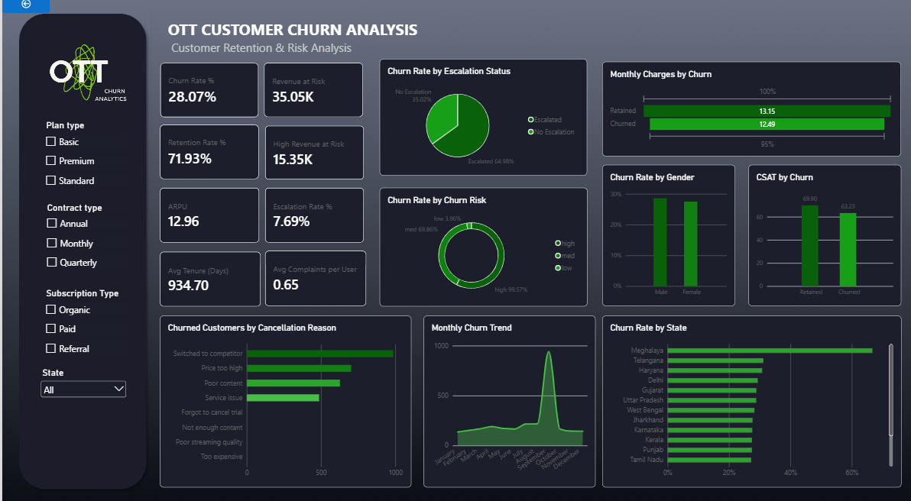
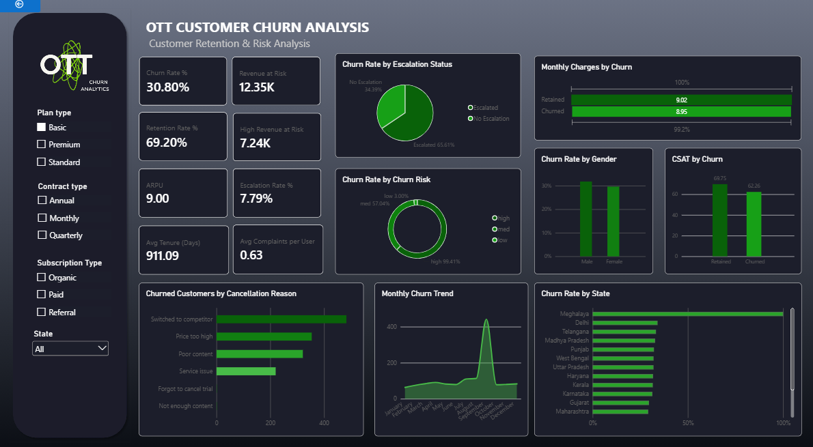
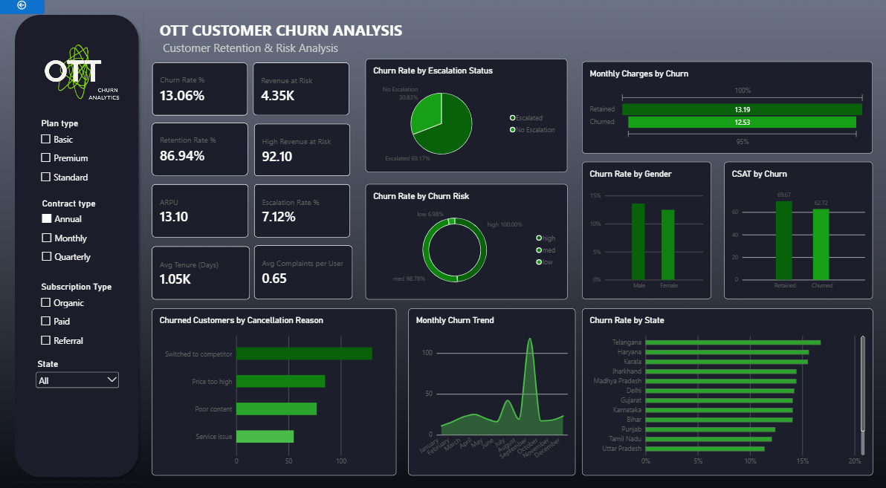
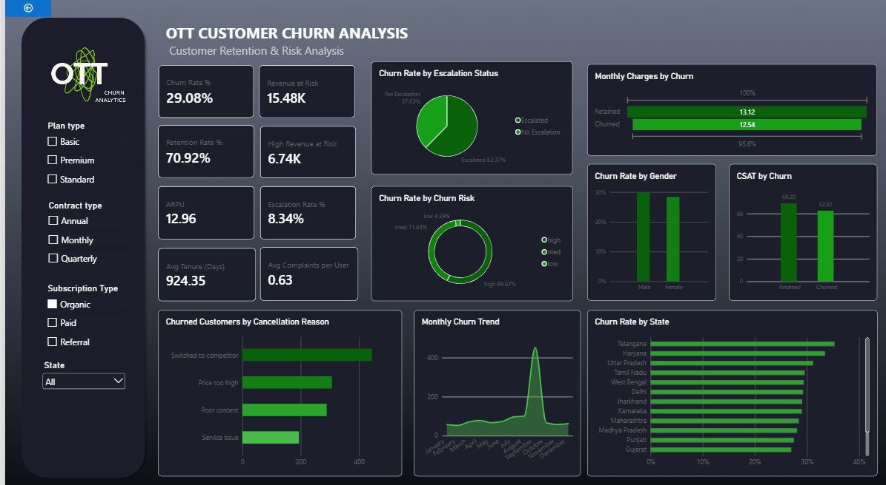
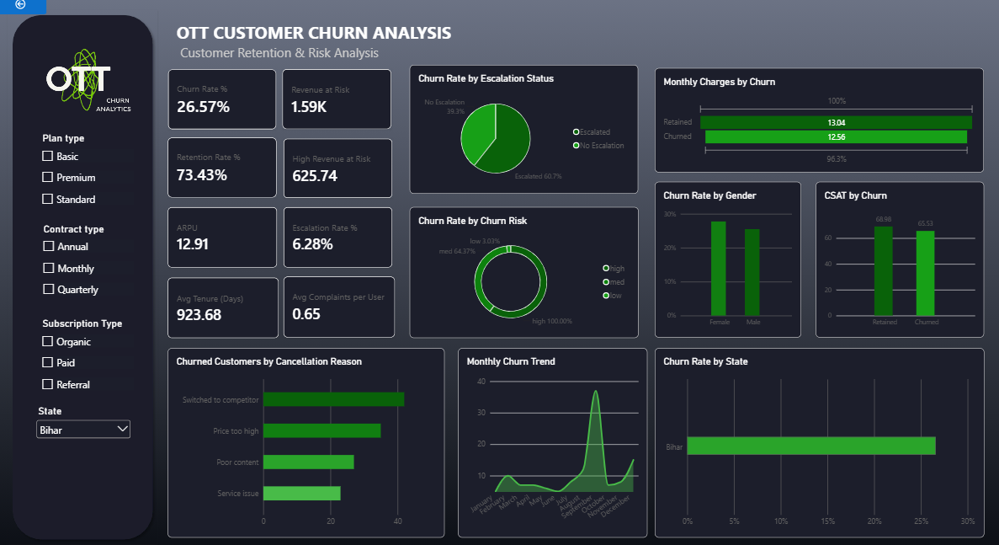

# 📊 OTT Customer Churn Analysis

### Customer Retention & Risk Analytics

An end-to-end data analytics project analyzing customer, subscription, and support data for an OTT streaming platform to identify churn patterns, high-risk customers, cancellation drivers, and revenue at risk.

---

## 🎯 Project Overview

Customer churn is a major challenge for subscription-based businesses. This project analyzes **10,000 customers**, their subscription information, and support interactions to understand:

- Who is churning?
- Why are customers leaving?
- Which segments have higher churn?
- How much revenue is associated with churned customers?
- Which customer groups should be prioritized for retention?

The analysis combines **Python-based exploratory analysis** with an interactive **Power BI dashboard**.

---

## 📌 Objectives

- Measure overall churn and retention
- Identify high-risk customer segments
- Analyze cancellation reasons
- Examine the relationship between support escalation and churn
- Analyze churn across plans, contracts, gender, and states
- Identify monthly churn patterns
- Quantify revenue at risk
- Develop actionable retention recommendations

---

## 🗂️ Dataset

The project uses three connected tables:

| Table | Records | Description |
|---|---:|---|
| `db_customer` | 10,000 | Customer demographics and profile information |
| `db_subscription` | 10,000 | Subscription, plan, charges, churn and cancellation data |
| `db_support` | 6,494 | Complaints, escalations and CSAT information |

### Data Model

```text
db_customer
     │
     ├── 1 : 1 ──► db_subscription
     │
     └── 1 : * ──► db_support
```

All tables are connected using `customerid`.

### Churn Definition

```text
Cancellation date present → Churned
Cancellation date blank    → Retained
```

---

## 🛠️ Tech Stack

- **Python**
- **Pandas**
- **NumPy**
- **Matplotlib**
- **Seaborn**
- **SQLite**
- **Jupyter Notebook**
- **Power BI**
- **DAX**
- **Excel**

---

## 🔄 Project Workflow

```text
Data Ingestion
      ↓
Data Cleaning
      ↓
Feature Engineering
      ↓
Exploratory Data Analysis
      ↓
KPI Development
      ↓
Power BI Data Modeling
      ↓
Interactive Dashboard
      ↓
Business Insights
      ↓
Recommendations
```

---

## 🧹 Data Preparation

The analysis included:

- Data type inspection and correction
- Date parsing and standardization
- Missing-value checks
- Gender standardization
- Category consistency checks
- State-to-country mapping for missing country values
- Row-count validation after merges
- Identification of latest support records per customer

### Engineered Features

- Churn Flag
- Customer Age
- Tenure
- Churn Risk
- Churn Score analysis

> **Note:** No predictive machine-learning model was built. Churn risk was derived from the dataset's existing churn score.

---

## 📊 Key KPIs

| KPI | Result |
|---|---:|
| **Churn Rate** | **28.07%** |
| **Retention Rate** | **71.93%** |
| **ARPU** | **12.96** |
| **Average Tenure** | **≈ 934 days** |
| **Revenue at Risk** | **35.05K** |
| **High-Risk Revenue at Risk** | **15.35K** |
| **Escalation Rate** | **7.69%** |
| **Avg Complaints / User** | **0.65** |

---

## 🔍 Key Findings

### 1. Overall Churn

**28.07%** of customers have churned, while **71.93%** remain retained.

### 2. High-Risk Customers

Customers classified as high risk based on churn score show substantially higher churn than lower-risk groups.

### 3. Revenue at Risk

**35.05K** in monthly charges is associated with churned customers.

**15.35K** is associated with customers classified as high risk.

### 4. Cancellation Drivers

The largest cancellation reason is **switching to a competitor**, followed by:

- Price too high
- Poor content
- Service issues

### 5. Support Escalation

Customers associated with support escalations show substantially higher churn:

**≈64.98% vs ≈35.02%**

This is an observed **association**, not proof that escalation causes churn.

### 6. Geographic & Monthly Patterns

Churn varies across states and shows noticeable monthly variation, including a late-year spike.

---

## 💡 Business Recommendations

### 🎯 Prioritize High-Risk Customers

Use churn-risk indicators to prioritize proactive retention efforts.

### 🔄 Address Competitor Switching

Review pricing, content value, plan flexibility, and retention offers.

### 🎧 Improve Support Resolution

Investigate escalated support cases and prioritize faster resolution and follow-up.

### 📺 Address Content & Value Concerns

Investigate pricing and content-related cancellations and consider targeted retention strategies.

### 💰 Protect Revenue at Risk

Prioritize retention efforts using churn risk and customer revenue/value.

### 🌍 Investigate Regional & Seasonal Patterns

Further investigate geographic and monthly patterns before introducing localized or time-based interventions.

---

## 📈 Power BI Dashboard

The interactive Power BI dashboard allows analysis across:

- Plan Type
- Contract Type
- Subscription Type
- State

### Dashboard Overview



### Plan Type Filter



### Contract Type Filter



### Subscription Type Filter



### State Filter



---

## 📁 Repository Structure

```text
OTT-Customer-Churn-Analysis/
│
├── README.md
├── OTT_Customer_Churn_Analysis.ipynb
├── customer_churn_expanded.xlsx
├── OTT Customer Churn Analysis.pbix
├── OTT_Customer_Churn_Analysis_Report.pdf
│
└── images/
    ├── dashboard-overview.png
    ├── dashboard-filter-plan_type.png
    ├── dashboard-filter-contract_type.png
    ├── dashboard-filter-subscription_type.png
    └── dashboard-filter-state.png
```

---

## 📄 Project Report

For the complete methodology, analysis, findings, KPIs, recommendations, and project documentation:

📑 **[View the Project Report](OTT_Customer_Churn_Analysis_Report.pdf)**

---

## 🚀 Future Scope

The following were **not implemented** in the current project but could extend the analysis:

- Predictive churn modeling
- Customer lifetime value analysis
- More detailed customer segmentation
- Automated retention workflows
- Real-time churn monitoring
- Deeper investigation of regional and seasonal churn drivers

---

## 📚 What I Learned

Through this project, I practiced:

- Data cleaning and validation
- Pandas-based analysis
- SQL/SQLite data handling
- Exploratory data analysis
- Feature engineering
- KPI development
- Power BI data modeling
- DAX measures
- Interactive dashboard design
- Translating analytical findings into business recommendations
- Distinguishing association from causation

---

## 👩‍💻 Author

**Sana Khurshid**

B.Tech — Computer Science & Engineering  
Data Science Specialization

---

⭐ If you found this project useful, feel free to explore the notebook, dashboard, and report.
```
